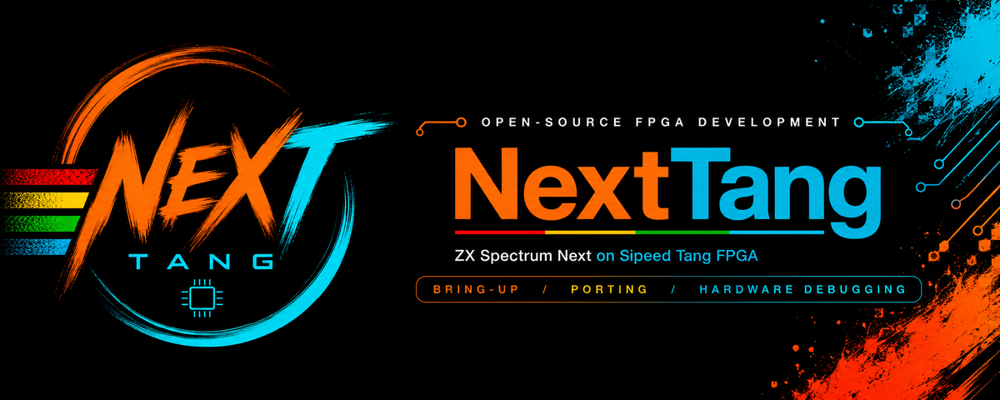

<p align="center">
  
</p>

<p align="center">
  <a href="LICENSE"></a>
  <a href="https://github.com/jattree/NextTang/actions/workflows/quality.yml"></a>
  <a href="#current-status"></a>
  <a href="#hardware-targets"></a>
  <a href="https://t.me/NextTang"></a>
  <a href="https://www.youtube.com/@NextTangFPGA"></a>
  <a href="https://github.com/jattree/NextTang/issues"></a>
</p>

<p align="center">
  <a href="ROADMAP.md">Roadmap</a> ·
  <a href="#hardware-targets">Hardware targets</a> ·
  <a href="docs/provenance.md">Provenance</a> ·
  <a href="docs/toolchain.md">Toolchain</a> ·
  <a href="https://t.me/NextTang">Telegram</a> ·
  <a href="https://www.youtube.com/@NextTangFPGA">YouTube</a> ·
  <a href="#contributing">Contributing</a> ·
  <a href="#references">References</a>
</p>

## Current status

> [!IMPORTANT]
> The Console 138K now runs the ZX Spectrum Next core: NextZXOS boots from the
> SD card and Next games play at full speed with 720p50 HDMI video and audio.
> It is not yet a complete Next. Below 28 MHz the browser is black and 48K
> games do not load, and boot still fails on many loads. The 48K, 128K and
> Spec256 profiles below remain standalone, hardware-verified platform slices.

The Next core is the imported ZXNext machine core from the MiSTer port (see
[provenance](docs/provenance.md)). Its 2 MB main memory lives in DDR3 behind a
16 KiB CPU line cache, its CPU runs on the 28 MHz machine clock with speed and
contention enables, and Layer 2 is mirrored into block RAM for two bank ranges.
The official System/Next boot loader, built from its GPL source, loads
`TBBLUE.FW` from the card and boots NextZXOS 2.09 to its menu and browser at
28 MHz. Gods – Fogjaw Edition and Warhawk play at full speed with clean Layer 2,
720p50 HDMI and HDMI audio. Not done yet: the slower CPU speeds, reliable boot
(on most images only about two loads in six reach the welcome page), 60 Hz output, the F1/F3/F4 keys,
Layer 2 outside the two mirrored ranges, and the real-time debugger. The
bring-up is shown in [Episode 6](https://youtu.be/sYmfuHmmCgw).

The 48K path boots a user-supplied Sinclair ROM through the imported T80 and
standard upstream ULA. The ULA-visible lower 16 KiB remains local while the
CPU's upper 32 KiB is served from calibrated onboard DDR3. User-supplied TZX
images load through the ROM's real tape path; both the standard loader and an
independent turbo loader have run on hardware. The native read-only SD loader
has also mounted the physical FAT32 card, cataloged `/games/Classic48`, streamed
Finders Keepers from TZX and reached gameplay before returning to its live menu.

The 128K profile keeps screen banks 5 and 7 local and serves the remaining six
banks through the same DDR3 service. It has booted the real 128 menu, run an
operator-entered BASIC program, and loaded standard-speed Spellbound from the
physical SD card through three minutes of multi-room gameplay. Three Weeks in
Paradise remains a custom turbo-loader failure. One
direct-attached USB controller is hardware-verified through Kempston input for
all four directions and fire.

The separate Spec256 runtime keeps the original 48K game executing while eight
graphical lanes carry enhanced per-pixel colour. One FPGA image accepts private
game packs without resynthesis. Exact hardware tests cover clean moving Jetpac,
Chuckie Egg, Cybernoid, Underwurlde, Knight Lore, Renegade, Sabre Wulf and Sink
Feel observations, direct USB play, backgrounds, `0xff` passthrough and audible
HDMI game audio. Into the Eagle's Nest remains a known runtime/display failure;
these bounded tests do not establish complete-game, general Spec256 or 128K
Spec256 compatibility. A separate local-memory SD profile has also mounted the
physical `/games/Spec256` catalogue, streamed and accepted an exact Jetpac pack
and sustained enhanced gameplay. Its combined DDR3 variant remains unverified.
The combined variant now places and routes with both fixed-role USB hosts and
the bounded POKE loader, but remains build-verified rather than hardware-tested.

Generated bitstreams, vendor work products, ROMs, games, packs and captures
remain outside Git. Source, constraints and regressions are under
[`boards/console138k/`](boards/console138k/), [`rtl/`](rtl/) and
[`tests/`](tests/). The hardware progression is shown on the
[NextTang YouTube channel](https://www.youtube.com/@NextTangFPGA).

Bring-up status is deliberately split between NextTang-owned behaviour and the
factory TangCore baseline:

| Area | Current evidence |
| --- | --- |
| JTAG and programming | Hardware-verified 6 MHz scan and volatile SRAM loading; Gowin `GW5AST-138`, IDCODE `0x1081b` |
| Clocks | The 50 MHz board input, in-range 1125 MHz video VCO, 75/375 MHz HDMI clocks and 28/14/7/3.5 MHz machine tree are connected in the current hardware-running images. Correcting the former out-of-range video VCO removed a content-dependent HDMI loss reproduced with Cybernoid; retained gameplay captures then ran without full-frame dropouts across four workloads. This is bounded evidence, not every-sink certification |
| UART | Hardware-decoded through an external FT232RL. The current image reports video lock, CPU opcodes, screen writes, complete scaled frames, overrun and capture-protocol status on each line |
| HDMI | Hardware-verified for 720p output, the standard 48K/50 Hz upstream ULA raster, frame-safe 50-to-60 Hz conversion and audible Spec256 game audio. AY plus beeper audio for the classic profiles is simulation- and exact-device build-verified but has not yet been heard on hardware |
| DDR3 | Hardware-verified on the 30354 1 GB Hynix SOM: calibration, paired writes, read-back, every usable address-line position, the 512 MB boundary and the final aligned 32-byte beat pass with distinct retained patterns. The first integrated machine workload also boots the 48K ROM with CPU addresses `0x8000`-`0xffff` served from DDR3 while the ULA-visible lower 16 KiB remains local. The Console input is 50 MHz and the working path retains Gowin's generated dynamic PLL and `PLL_INIT`. Exhaustive every-cell, sustained-load and banked-Next testing remain open ([resolved issue #5](https://github.com/jattree/NextTang/issues/5)) |
| Tape | Hardware-verified. A user-supplied TZX is played into the EAR input for the ROM's own loader. Manic Miner loads and runs; Cobra loads through its own turbo speed loader to its credits. The tape and every generated memory image stay outside Git |
| SD | The NextTang-owned read-only SDHC/FAT32/LFN path has bounded hardware passes for 48K Finders Keepers, standard-speed 128K Spellbound and one local-memory Spec256 Jetpac pack. Three Weeks in Paradise's turbo loader, TAP, broader cards/filesystems, the combined Spec256/DDR3 profile and persistent boot remain unverified |
| Audio | Audible Jetpac audio is hardware-verified through the Spec256 HDMI path. The reusable AY-3-8912 plus beeper mixer and tape-EAR mix are simulated and exact-device build-verified for the classic profiles; tape sound has not yet been heard on hardware |
| USB HID | Direct FPGA-hosted keyboard input is hardware-verified in 48K, 128K and Spec256 profiles with one exact keyboard. One direct-attached controller is hardware-verified through Kempston input. The combined Spec256 build now retains both with fixed roles (USB1 gamepad, USB2 keyboard), but that simultaneous arrangement, hubs and broad device compatibility remain unverified |
| POKE | Versioned CRC-protected packs support up to eight atomic writes to 48K logical RAM, 128K logical/physical banks, or Spec256 main/graphical memory. Simulation and exact-device builds pass; no POKE pack has yet been applied on hardware |

The first DDR-to-video integration is also hardware-verified. An exact-C demo
stores the 16 KiB RGB332 logo in onboard DDR3, repeatedly refills alternating
on-chip display buffers from DDR3, and advances the logo only after a complete
refill. This proves a bounded live DDR consumer, not the machine CPU/video
memory service or a full-screen DDR framebuffer.

The platform groundwork now covers machine clocks, DDR3, 48K and 128K memory,
video, direct USB input, runtime loading, bounded SD paths for all three current
profiles, atomic bank-aware POKE packs, and HDMI game/tape audio paths. The
remaining gaps are explicitly hardware-level compatibility checks rather than
missing platform interfaces. The [starter roadmap](ROADMAP.md) defines the
required evidence before those build-only paths are promoted.

The one part of the project not waiting on that board is the
[host tooling track](ROADMAP.md#host-tooling-track), which builds the DZRP client and
command-subset conformance suite against existing remotes.

## What NextTang is

NextTang is an independent, community-developed port of the
[ZX Spectrum Next](https://www.specnext.com/) FPGA implementation to
[Sipeed Tang Console](https://wiki.sipeed.com/hardware/en/tang/tang-console/mega-console.html)
boards. The initial hardware target is the Tang Console 138K, with a shared
platform design intended to support the Tang Console 60K as well.

The project starts from the actively maintained
[MiSTer ZXNext core](https://github.com/MiSTer-devel/ZXNext_MISTer), which is a
port of the [official ZX Spectrum Next FPGA sources](https://gitlab.com/SpectrumNext/ZX_Spectrum_Next_FPGA).
It will replace the MiSTer-specific platform layer with a Gowin/Tang platform
shell rather than reimplementing the Next specification from scratch.

The project grew from the community discussion about the unavailable
[NextNano v0.1 corresponding source](https://github.com/RetroSilicon/NextNano/issues/1).
NextTang does not depend on that source becoming available, but future
cooperation or code sharing is welcome where technically and legally possible.

## Goals

- Boot and run ZX Spectrum Next software on supported Tang Console boards.
- Keep the ZXNext logic close to its upstream source and isolate board-specific
  clocks, memory, video, audio, storage, and input behind narrow interfaces.
- Support both 60K and 138K targets from one source tree rather than through
  divergent forks.
- Add developer-oriented hardware debugging: halt, step, registers, MMU state,
  page-aware breakpoints, watchpoints, and triggered instruction tracing.
- Publish source, build instructions, exact tool versions, test artifacts, and
  known compatibility limits.

## Non-goals

- Claiming endorsement by or equivalence to official ZX Spectrum Next hardware.
- Treating emulator or alternate-FPGA results as official-hardware proof.
- Redistributing NextZXOS, ROMs, games, or other third-party copyrighted files.
- Making the first bitstream wait for the complete debugger.

## Hardware targets

| Target | Intended role | Status |
| --- | --- | --- |
| Tang Console 138K | Initial port, full development instrumentation, deep trace | `GW5AST-LV138PG484AC1/I0` identified; JTAG, DDR3, 48K CPU/ROM/BASIC, standard upstream ULA and frame-safe 720p output hardware-verified for the inspected 30354 1 GB SOM configuration |
| Tang Console 60K | Portable release core and lighter debugging | Planned; contributor wanted |
| Tang Nano 20K | Later compact release target; not a development platform | In scope; not currently scheduled |

Both Console targets will use the same core and debugger protocol. Features
that depend on available FPGA resources will be discovered at runtime through a
capability bitmap instead of creating incompatible tools.

## Planned build profiles

| Profile | Purpose | Expected targets |
| --- | --- | --- |
| `release` | Smallest compatible core without development instrumentation | 60K and 138K |
| `debug-lite` | Halt, step, state inspection, and a small breakpoint set | 60K and 138K if synthesis permits |
| `debug-full` | Extended watchpoints and deep triggered trace | 138K initially |

Resource availability is not assumed. Each profile must pass synthesis and
timing analysis on its exact FPGA device and board revision.

## Planned architecture

```text
rtl/                 Shared ZXNext RTL
platform/common/     Shared platform and capability interfaces
boards/nano20k/      20K compact release top level and constraints
boards/console60k/   60K top level, constraints, PLL, and memory IP
boards/console138k/  138K top level, constraints, PLL, and memory IP
debug/               Debug control, breakpoints, watchpoints, and trace
host/                Host-side protocol tools and debugger integration
sim/                 Portable simulations and fixtures
tests/               Build, compatibility, and hardware smoke tests
docs/                Architecture, provenance, and verification records
```

The [starter roadmap](ROADMAP.md) turns this structure into milestones with
explicit completion evidence.

## Developer setup

The repository has deterministic quality checks and fail-closed synthesis entry
points. The Console 138K has a vendor `release` driver for the verified smoke
image. This driver does not build the planned machine core.

`make check` drives three external tools directly and fails without them, on
either toolchain: `iverilog` for the Verilog testbenches, `ghdl` for the VHDL
testbenches and `sjasmplus` for the diagnostic boot ROM. `make doctor` names any
that are missing. On Debian or Ubuntu:

```bash
sudo apt-get install iverilog ghdl
```

`sjasmplus` is not packaged; build it from the tag pinned in
[`toolchain/versions.env`](toolchain/versions.env), as
[`.github/workflows/quality.yml`](.github/workflows/quality.yml) does.

```bash
cp .env.example .env.local
make doctor
make check
make show-config
make TOOLCHAIN=vendor TARGET=console138k PROFILE=release synth
```

The hardware-verified destructive DDR3 diagnostic has a separate build entry
because its generated Gowin controller and PLL sources cannot be redistributed
by this repository. Generate or obtain the matching files locally, keep them
outside Git, then provide their containing directory explicitly:

```bash
mkdir -p /tmp/nexttang-ddr3-build
boards/console138k/build_ddr3.sh \
  --toolchain vendor \
  --profile diagnostic \
  --vendor-source /absolute/path/to/ddr_memory_test_uart/src \
  --output /tmp/nexttang-ddr3-build
```

The driver requires an empty output directory, checks fresh reports and timing,
and records repository and vendor-source hashes beside the generated bitstream.

The first hardware-verified machine/DDR integration uses the same private
vendor-source boundary. It keeps the lower 16 KiB local for the ULA and serves
the upper 32 KiB from DDR3:

```bash
mkdir -p /tmp/nexttang-spectrum48-ddr
NEXTTANG_48K_ROM=/absolute/path/to/48.rom \
boards/console138k/build_spectrum48.sh \
  --toolchain vendor \
  --profile ula-ddr-upper \
  --vendor-source /absolute/path/to/generated/ddr3/source \
  --output /tmp/nexttang-spectrum48-ddr
```

The ROM and generated Gowin DDR3/PLL sources are user-supplied build inputs and
are not redistributed by this repository.

See the [toolchain guide](docs/toolchain.md) for the provisional Gowin and
open-source tool versions and supported target/profile combinations. Other
target, profile and toolchain combinations remain unimplemented and fail closed.
Board integrations must implement the documented
[build-driver contract](boards/README.md).

Public technical decisions and verification evidence belong in the relevant
documentation, GitHub issue, or pull request so contributors can inspect and
reproduce them.

## Contributing

The project is at the stage where early hardware and toolchain experience has
high leverage. Useful contribution areas include:

- Tang Console 60K or 138K board ownership and repeatable hardware testing;
- Gowin EDA, [Yosys](https://github.com/YosysHQ/yosys),
  [nextpnr](https://github.com/YosysHQ/nextpnr), or
  [Project Apicula](https://github.com/YosysHQ/apicula) experience;
- mixed VHDL/SystemVerilog integration;
- DDR3, HDMI, SD, USB HID, and onboard USB controller firmware;
- Z80N/Next compatibility testing; and
- FPGA trace and source-debugger design.

Read [CONTRIBUTING.md](CONTRIBUTING.md), then start with a
[GitHub issue](https://github.com/jattree/NextTang/issues) stating
which board and exact silicon revision you have, which operating system and
toolchain you can use, and the area you would like to work on. Small,
independently verifiable contributions are preferred.

Project discussion, coordination, announcements, and roadmap updates are hosted
in the [NextTang Telegram group](https://t.me/NextTang). Less technical project
updates and build videos are on the [NextTang YouTube channel](https://www.youtube.com/@NextTangFPGA).

## References

- [Official ZX Spectrum Next FPGA repository](https://gitlab.com/SpectrumNext/ZX_Spectrum_Next_FPGA)
- [MiSTer ZXNext core](https://github.com/MiSTer-devel/ZXNext_MISTer)
- [Pinned upstream and per-file provenance audit](docs/provenance.md)
- [Adjacent Tang project evidence and reuse boundaries](docs/adjacent-projects.md)
- [YouTube channel CLI for project host tooling](docs/youtube-cli.md)
- [Sipeed Tang Console documentation](https://wiki.sipeed.com/hardware/en/tang/tang-console/mega-console.html)
- [Sipeed Tang Mega 138K examples](https://github.com/sipeed/TangMega-138K-example)
- [ZXSpectrumNextTests](https://github.com/MrKWatkins/ZXSpectrumNextTests)
- [DeZog Remote Protocol](https://github.com/maziac/DeZog/blob/main/design/DeZogProtocol.md)
- [JNext emulator and debugger](https://github.com/jorgegv/jnext)
- [dezogif](https://github.com/maziac/dezogif) and
  [dezogif_ng](https://github.com/jorgegv/dezogif_ng), DZRP debug stubs for real Next hardware
- [NextNano source discussion](https://github.com/RetroSilicon/NextNano/issues/1)

## Independence and license

NextTang is not affiliated with or endorsed by SpecNext Ltd, Sipeed, MiSTer,
or RetroSilicon. Product and project names belong to their respective owners.

Original work in this repository is released under the
[GNU General Public License v3.0](LICENSE). Imported source will retain its
copyright, attribution, modification notices, and license terms. The
[upstream audit and import policy](docs/provenance.md) records the selected
baseline before any upstream HDL is committed. Synthesized releases containing
the audited BSD-style components must include
[the third-party notices](THIRD_PARTY_NOTICES.md).
