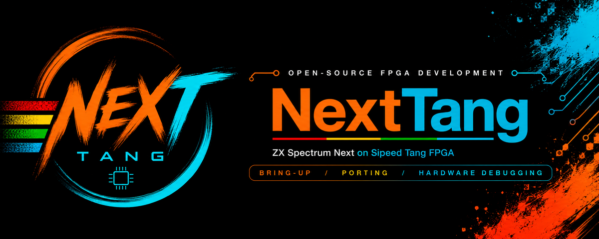

<p align="center">
  
</p>

<p align="center">
  <a href="LICENSE"></a>
  <a href="https://github.com/jattree/NextTang/actions/workflows/quality.yml"></a>
  <a href="#current-status"></a>
  <a href="#hardware-targets"></a>
  <a href="https://t.me/NextTang"></a>
  <a href="https://www.youtube.com/@JonOverDoesIt"></a>
  <a href="https://github.com/jattree/NextTang/issues"></a>
</p>

<p align="center">
  <a href="ROADMAP.md">Roadmap</a> ·
  <a href="#hardware-targets">Hardware targets</a> ·
  <a href="docs/provenance.md">Provenance</a> ·
  <a href="docs/toolchain.md">Toolchain</a> ·
  <a href="https://t.me/NextTang">Telegram</a> ·
  <a href="https://www.youtube.com/@JonOverDoesIt">YouTube</a> ·
  <a href="#contributing">Contributing</a> ·
  <a href="#references">References</a>
</p>

## Current status

> [!IMPORTANT]
> The Console 138K runs the ZX Spectrum Next core. On official core 3.02.03,
> NextZXOS boots from the SD card, Next games and classic 48K and 128K games
> run, and Spec256 games play in 256 colours inside the Next core. On official
> core 3.02.05, NextZXOS boots and the official Pi debug interface works with
> NextTang's host debugger and hardware breakpoints. This tree joins the two:
> Spec256 on 3.02.05 with the debugger. That combination is build-verified and
> awaiting its hardware check. It is not yet a complete Next.

Evidence levels are kept apart throughout: **planned** means nothing is built
yet; **simulation** means a testbench passes; **build** means the exact image
places and routes with timing met; **hardware** means it was seen working on a
board, within the stated limits.

| Feature | Board | Level | Notes |
| --- | --- | --- | --- |
| Next core, official 3.02.03 | Console 138K | Hardware | NextZXOS 2.09 boots from the card (10 of 10 repeat boots); 28, 14, 7 and 3.5 MHz; Next games at full speed; 48K and 128K games from tape files; 50 or 60 Hz HDMI; USB keyboard and joystick |
| Next core, official 3.02.05 | Console 138K | Hardware | NextZXOS welcome screen with the debugger builds below. With the debugger off the merged core matches 3.02.03 cycle for cycle over 2,000,000 cycles in simulation. Broad game testing was done on 3.02.03 |
| Spec256 inside the Next core | Console 138K | Hardware (on 3.02.03) | One `.256` per game, started from the NextZXOS browser by the `.SPEC256` dot command. In a recorded survey all 38 conversions tried loaded, showed colour and reached gameplay; that is a gameplay survey, not full-game compatibility |
| ZX-Poly video modes 4, 6 and 7 | Console 138K | Hardware for modes 4 and 6; simulation for 7 | Modes 4 and 6 drew titles, menus and first rooms or levels in colour. A mode 7 game showed a correct title but did not start, so mode 7 is verified in simulation only |
| Pi debug interface and host debugger | Console 138K | Hardware | Over the debug UART: pause, registers, memory, single steps and breakpoints on jump, call, return and relative-jump targets, optionally page-qualified; 17 of 19 checks in dezogif_ng's DZRP conformance subset (the two sprite commands are not reachable). DeZog itself in VS Code not yet tried |
| Combined 3.02.05 + Spec256 + debugger | Console 138K | Build | This tree. Hardware check pending |
| Pi 5 over PCIe | Console 138K + Pi 5 | Hardware (link and test design) | 5 GT/s x1 link; the Pi read and wrote FPGA memory through a small test design, 1,500,000 rounds of 16 words with no mismatches. The Next core over PCIe is not built yet; the Tang must be loaded after the Pi has booted |
| Next core | Tang Nano 20K | Planned | Parallel development target with Pi0 support through the official Pi debug interface. No NextTang build or hardware result |
| Next core | Console 60K | Planned | Build-only until a board is available. No build yet |
| Official core 3.03.00 (System/Next 26.11) | — | Planned | Released as a binary only; its VHDL is not yet public. NextTang will follow when it is |

### The Next core

The Next core is the official ZX Spectrum Next core, merged file by file onto
the MiSTer port it started from; three MiSTer pieces are kept (see
[provenance](docs/provenance.md)). It moves to each official release with
[`scripts/merge_official_core.py`](scripts/merge_official_core.py), a
three-way merge of every official file against the version last taken, so
NextTang's own changes inside official files stay small and are marked
`NextTang`. The current base is 3.02.05 (official branch `30205`).

Its 2 MB main memory lives in DDR3 behind a 16 KiB CPU line cache, its CPU
runs on the 28 MHz machine clock with speed and contention enables, the HDMI
frame store is in DDR3, and Layer 2 is mirrored into block RAM for banks 8 to
31. The official System/Next boot loader, built from its GPL source, loads
`TBBLUE.FW` from the card. On 3.02.03, Sanxion ran at 7 MHz and Trashman at
3.5 MHz from tape files, Castlevania: Spectral Interlude loaded as a 128K
game to its title and menu with music, and Gods – Fogjaw Edition played at
full speed with clean Layer 2. F1 (hard reset), F4 (soft reset), F8 (CPU
speed) and F3 (50/60 Hz, with the HDMI output following) work from the USB
keyboard. Not done yet: Layer 2 in banks 32 and above. The bring-up is shown
in [Episode 6](https://youtu.be/sYmfuHmmCgw) and the slower speeds in
[Episode 7](https://youtu.be/IYaPcpsD9Rs).

Bank 5's CPU-port write is registered, as proposed in
[RetroSilicon/NextNano issue #14](https://github.com/RetroSilicon/NextNano/issues/14)
for layout-dependent corruption on Gowin parts. NextTang has not seen that
fault; the change matches the core without it cycle for cycle in simulation
and is part of the pending hardware check.

### Spec256 inside the Next core

Each game is one `.256` file in Alberto Conde's
[SPEC256_MISTER](https://github.com/albconde/SPEC256_MISTER) format, read
unmodified, picked in the NextZXOS browser and loaded by the `.SPEC256` dot
command ([`firmware/spec256dot/`](firmware/spec256dot/)). The game runs on the
Next's own Z80 while eight more Z80s follow its control flow, one 28 MHz
clock tick behind, each with its own bit of colour data. For 48K games the
384 KiB of colour planes reuse the Layer 2 memory widened for the Next core;
128K games get extra colour banks in DDR3, and painted backgrounds live in
DDR3 too, chosen once a frame by each game's own rules. An optional per-game
setting (OPT1 byte 8, bit 0) makes FLASH cells blink, as some menus need; it
is hardware-verified, and files without it behave as before.

ZX-Poly's video modes 4, 6 and 7 (from Igor Maznitsa's
[ZX-Poly](https://github.com/raydac/zxpoly)) are supported for `.256` files
that ask for them, with the evidence levels in the table above.

[`tools/spec256/patch256.py`](tools/spec256/) applies English text patches
to the user's own copy of a Spanish conversion; the patches change only
text.

### Debugging

The core carries the official Pi debug interface (`pi_debug_control`), the
one the Next team's Pi tools use. On the Console an FPGA SPI master plays the
Pi's part, so a host reaches it over the debug UART; NextTang adds ten
hardware PC breakpoints, optionally qualified by an 8K page. The host side,
[`host/debug/`](host/debug/), has a command line (`nexttang-debug`) and a DZRP
bridge for [DeZog](https://github.com/maziac/DeZog) that follows
[JNext](https://github.com/jorgegv/jnext)'s DZRP server. Four defects found in
the official single-step and register-write paths are fixed in NextTang's CPU
and reproduced in simulation. In this tree the Spec256 colour CPUs take the
debugger's pauses and breakpoint stops too, and stay in lockstep through them
in simulation; a register the debugger writes changes only the main CPU. See
[docs/debugger.md](docs/debugger.md).

### Raspberry Pi 5 over PCIe

The Console 138K with a Raspberry Pi 5 is NextTang's flagship pairing, with
the Pi as debug host over PCIe. On the bench the
Pi 5 links to the Console at 5 GT/s, x1, and reads and writes FPGA memory
through a small test design with no errors over 1.5 million rounds. The link
comes up when the Tang is configured after the Pi's boot clock has started.
Not yet shown: the Next core or the debugger over PCIe, and the link across
Pi reboots or a cold start.

### Standalone platform profiles

Before the Next core, NextTang verified its platform in standalone 48K, 128K
and Spec256 profiles, which remain in [`boards/console138k/`](boards/console138k/).
The 48K profile boots a user-supplied ROM through the T80 and the standard
upstream ULA with its upper 32 KiB in DDR3, and loads TZX images through the
ROM's tape path. The 128K profile has booted the 128 menu and loaded
Spellbound from the SD card. The standalone Spec256 runtime played Jetpac,
Chuckie Egg and others in colour from private game packs. Three Weeks in
Paradise's turbo loader and the combined Spec256/SD/DDR3 standalone image
remain unverified.

| Area | Current evidence |
| --- | --- |
| JTAG and programming | Hardware-verified 6 MHz scan and volatile SRAM loading; Gowin `GW5AST-138`, IDCODE `0x1081b` |
| Clocks | The 50 MHz board input, in-range 1125 MHz video VCO, 75/375 MHz HDMI clocks and 28/14/7/3.5 MHz machine tree are in every hardware-running image |
| UART | Hardware-decoded through an external FT232RL; carries status lines, host commands and the debugger |
| HDMI | 720p output, 50 and 60 Hz, with game audio, hardware-verified. Tested on one monitor and one capture card, not every sink |
| DDR3 | Hardware-verified on the 30354 1 GB Hynix SOM: calibration, every usable address-line position and the final beat; it holds the Next's 2 MB main memory, the frame store and Spec256's 128K colour banks and backgrounds. Exhaustive every-cell testing remains open |
| SD | The Next core uses the card through NextZXOS. The standalone profiles' own read-only FAT32 loader has bounded hardware passes |
| USB HID | Direct FPGA-hosted keyboard and one controller, hardware-verified with the exact devices tested; hubs and broad device compatibility unverified |

Generated bitstreams, vendor work products, ROMs, games, packs and captures
remain outside Git. The hardware progression is shown on the
[JonOverDoesIt YouTube channel](https://www.youtube.com/@JonOverDoesIt).

## Companion projects

- [NexClash](https://github.com/bleughb/nexclash): Dean Woodyatt's patcher
  that turns a Spectrum game into a Next `.nex` in which the game's figures
  are Next hardware sprites, coloured from painted sprite sheets. Its builds
  use only stock Next features.
- [.nxc](https://github.com/jattree/nxc): a patch format and tools that carry
  such builds as patches, applied to the user's own copy of the game.

## What NextTang is

NextTang is an independent, community-developed port of the
[ZX Spectrum Next](https://www.specnext.com/) FPGA implementation to
[Sipeed Tang Console](https://wiki.sipeed.com/hardware/en/tang/tang-console/mega-console.html)
boards. The first and flagship target is the Tang Console 138K paired with a
Raspberry Pi 5; the Tang Console 60K and the Tang Nano 20K are planned on the
same source tree.

The project starts from the actively maintained
[MiSTer ZXNext core](https://github.com/MiSTer-devel/ZXNext_MISTer), which is a
port of the [official ZX Spectrum Next FPGA sources](https://gitlab.com/SpectrumNext/ZX_Spectrum_Next_FPGA).
It replaces the MiSTer-specific platform layer with a Gowin/Tang platform
shell rather than reimplementing the Next specification from scratch, and
follows each official core release that publishes its VHDL.

The project grew from the community discussion about the unavailable
[NextNano v0.1 corresponding source](https://github.com/RetroSilicon/NextNano/issues/1).
NextTang does not depend on that source becoming available, but future
cooperation or code sharing is welcome where technically and legally possible.

## Goals

- Boot and run ZX Spectrum Next software on supported Tang Console boards.
- Keep the ZXNext logic close to its upstream source and isolate board-specific
  clocks, memory, video, audio, storage, and input behind narrow interfaces.
- Support the Console 138K, Console 60K and Nano 20K from one source tree
  rather than through divergent forks.
- Add developer-oriented hardware debugging: halt, step, registers, MMU state,
  page-aware breakpoints, watchpoints, and triggered instruction tracing.
- Publish source, build instructions, exact tool versions, test artifacts, and
  known compatibility limits.

## Non-goals

- Claiming endorsement by or equivalence to official ZX Spectrum Next hardware.
- Treating emulator or alternate-FPGA results as official-hardware proof.
- Redistributing NextZXOS, ROMs, games, or other third-party copyrighted files.
- Making the first bitstream wait for the complete debugger.

## Hardware targets

| Target | Intended role | Status |
| --- | --- | --- |
| Tang Console 138K with a Raspberry Pi 5 | Flagship: the full core, deepest debugging, the Pi 5 as host over PCIe | `GW5AST-LV138PG484AC1/I0` on the 30354 1 GB SOM. The Next core, Spec256 and the debugger are hardware-verified as recorded above; the Pi 5 PCIe link is hardware-verified with a test design only |
| Tang Console 60K | Shared-source release target | Planned. Build-only until a board is available; no build yet |
| Tang Nano 20K | Parallel development target, with Pi0 support through the official Pi debug interface | Planned. No NextTang build or hardware result. Board revisions v3921 and v3923 differ and must be named with any result |

All targets will use the same core and debugger protocol. Features
that depend on available FPGA resources will be discovered at runtime through a
capability bitmap instead of creating incompatible tools.

## Planned build profiles

| Profile | Purpose | Expected targets |
| --- | --- | --- |
| `release` | Smallest compatible core without development instrumentation | 138K, 60K and Nano 20K |
| `debug-lite` | Halt, step, state inspection, and a small breakpoint set | 60K and 138K if synthesis permits |
| `debug-full` | Extended watchpoints and deep triggered trace | 138K initially |

Resource availability is not assumed. Each profile must pass synthesis and
timing analysis on its exact FPGA device and board revision.

## Planned architecture

```text
rtl/                 Shared ZXNext RTL
platform/common/     Shared platform and capability interfaces
boards/nano20k/      Nano 20K top level and constraints
boards/console60k/   60K top level, constraints, PLL, and memory IP
boards/console138k/  138K top level, constraints, PLL, and memory IP
debug/               Debug control, breakpoints, watchpoints, and trace
host/                Host-side protocol tools and debugger integration
sim/                 Portable simulations and fixtures
tests/               Build, compatibility, and hardware smoke tests
docs/                Architecture, provenance, and verification records
```

The [starter roadmap](ROADMAP.md) turns this structure into milestones with
explicit completion evidence.

## Developer setup

The repository has deterministic quality checks and fail-closed synthesis entry
points. The Next core for the Console 138K is built by
[`boards/console138k/build_zxnext.sh`](boards/console138k/build_zxnext.sh).

`make check` drives three external tools directly and fails without them, on
either toolchain: `iverilog` for the Verilog testbenches, `ghdl` for the VHDL
testbenches and `sjasmplus` for the diagnostic boot ROM. `make doctor` names any
that are missing. On Debian or Ubuntu:

```bash
sudo apt-get install iverilog ghdl
```

`sjasmplus` is not packaged; build it from the tag pinned in
[`toolchain/versions.env`](toolchain/versions.env), as
[`.github/workflows/quality.yml`](.github/workflows/quality.yml) does.

```bash
cp .env.example .env.local
make doctor
make check
make show-config
make TOOLCHAIN=vendor TARGET=console138k PROFILE=release synth
```

The Next core with its main memory in DDR3 needs Sipeed's generated DDR3
controller and PLL sources, which carry no redistribution grant, and a boot
loader image, such as the System/Next IPL built from its GPL source by
[`scripts/build_next_ipl.sh`](scripts/build_next_ipl.sh). Both stay outside
Git:

```bash
mkdir -p /tmp/nexttang-zxnext
boards/console138k/build_zxnext.sh \
  --toolchain vendor \
  --profile diagnostic-ddr3 \
  --vendor-source /absolute/path/to/ddr_memory_test_uart/src \
  --boot-image /absolute/path/to/loader.bin \
  --output /tmp/nexttang-zxnext
```

The hardware-verified destructive DDR3 diagnostic has a separate build entry
because its generated Gowin controller and PLL sources cannot be redistributed
by this repository. Generate or obtain the matching files locally, keep them
outside Git, then provide their containing directory explicitly:

```bash
mkdir -p /tmp/nexttang-ddr3-build
boards/console138k/build_ddr3.sh \
  --toolchain vendor \
  --profile diagnostic \
  --vendor-source /absolute/path/to/ddr_memory_test_uart/src \
  --output /tmp/nexttang-ddr3-build
```

The driver requires an empty output directory, checks fresh reports and timing,
and records repository and vendor-source hashes beside the generated bitstream.

The first hardware-verified machine/DDR integration uses the same private
vendor-source boundary. It keeps the lower 16 KiB local for the ULA and serves
the upper 32 KiB from DDR3:

```bash
mkdir -p /tmp/nexttang-spectrum48-ddr
NEXTTANG_48K_ROM=/absolute/path/to/48.rom \
boards/console138k/build_spectrum48.sh \
  --toolchain vendor \
  --profile ula-ddr-upper \
  --vendor-source /absolute/path/to/generated/ddr3/source \
  --output /tmp/nexttang-spectrum48-ddr
```

The ROM and generated Gowin DDR3/PLL sources are user-supplied build inputs and
are not redistributed by this repository.

See the [toolchain guide](docs/toolchain.md) for the provisional Gowin and
open-source tool versions and supported target/profile combinations. Other
target, profile and toolchain combinations remain unimplemented and fail closed.
Board integrations must implement the documented
[build-driver contract](boards/README.md).

Public technical decisions and verification evidence belong in the relevant
documentation, GitHub issue, or pull request so contributors can inspect and
reproduce them.

## Contributing

The project is at the stage where early hardware and toolchain experience has
high leverage. Useful contribution areas include:

- Tang Console 60K or 138K board ownership and repeatable hardware testing;
- Gowin EDA, [Yosys](https://github.com/YosysHQ/yosys),
  [nextpnr](https://github.com/YosysHQ/nextpnr), or
  [Project Apicula](https://github.com/YosysHQ/apicula) experience;
- mixed VHDL/SystemVerilog integration;
- DDR3, HDMI, SD, USB HID, and onboard USB controller firmware;
- Z80N/Next compatibility testing; and
- FPGA trace and source-debugger design.

Read [CONTRIBUTING.md](CONTRIBUTING.md), then start with a
[GitHub issue](https://github.com/jattree/NextTang/issues) stating
which board and exact silicon revision you have, which operating system and
toolchain you can use, and the area you would like to work on. Small,
independently verifiable contributions are preferred.

Project discussion, coordination, announcements, and roadmap updates are hosted
in the [NextTang Telegram group](https://t.me/NextTang). Less technical project
updates and build videos are on the [JonOverDoesIt YouTube channel](https://www.youtube.com/@JonOverDoesIt).

## References

- [Official ZX Spectrum Next FPGA repository](https://gitlab.com/SpectrumNext/ZX_Spectrum_Next_FPGA)
- [MiSTer ZXNext core](https://github.com/MiSTer-devel/ZXNext_MISTer)
- [Pinned upstream and per-file provenance audit](docs/provenance.md)
- [Adjacent Tang project evidence and reuse boundaries](docs/adjacent-projects.md)
- [YouTube channel CLI for project host tooling](docs/youtube-cli.md)
- [Sipeed Tang Console documentation](https://wiki.sipeed.com/hardware/en/tang/tang-console/mega-console.html)
- [Sipeed Tang Mega 138K examples](https://github.com/sipeed/TangMega-138K-example)
- [ZXSpectrumNextTests](https://github.com/MrKWatkins/ZXSpectrumNextTests)
- [DeZog Remote Protocol](https://github.com/maziac/DeZog/blob/main/design/DeZogProtocol.md)
- [JNext emulator and debugger](https://github.com/jorgegv/jnext)
- [dezogif](https://github.com/maziac/dezogif) and
  [dezogif_ng](https://github.com/jorgegv/dezogif_ng), DZRP debug stubs for real Next hardware
- [NextNano source discussion](https://github.com/RetroSilicon/NextNano/issues/1)

## Independence and license

NextTang is not affiliated with or endorsed by SpecNext Ltd, Sipeed, MiSTer,
or RetroSilicon. Product and project names belong to their respective owners.

Original work in this repository is released under the
[GNU General Public License v3.0](LICENSE). Imported source will retain its
copyright, attribution, modification notices, and license terms. The
[upstream audit and import policy](docs/provenance.md) records the selected
baseline before any upstream HDL is committed. Synthesized releases containing
the audited BSD-style components must include
[the third-party notices](THIRD_PARTY_NOTICES.md).
